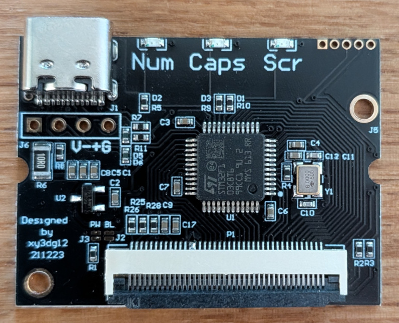
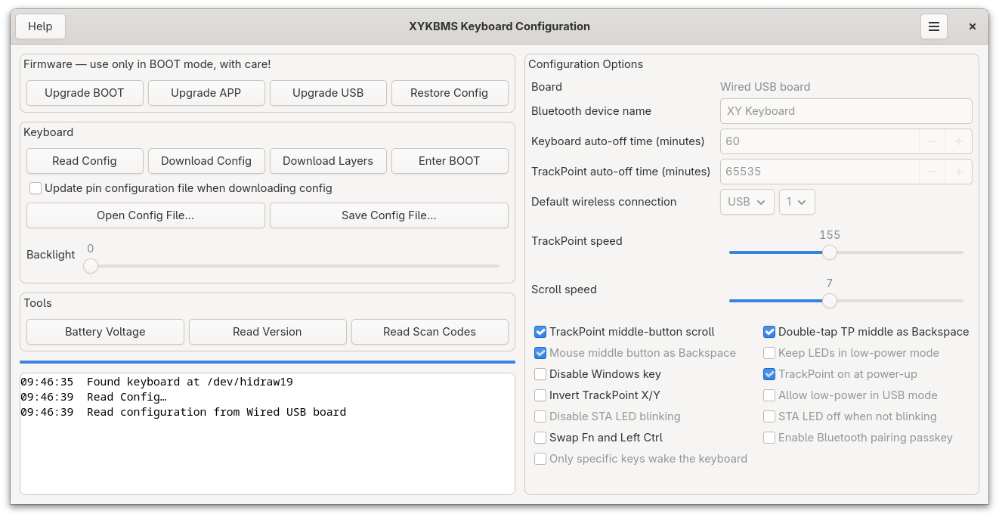

# xykbms-gtk

A GTK GUI for configuring Thinkpad Classic Keyboard to USBC converter boards



This is native Linux (GTK 4) replacement for `XYKBMS_SwUpdate.exe`, the Windows tool used to
configure and update the XY (xy_3dg12, USB VID `0x5859`) ThinkPad keyboard controller boards.

The HID protocol was reverse engineered from the Windows binary; see [PROTOCOL.md](PROTOCOL.md).



## Features

Everything the Windows tool does:

* read, modify and download the keyboard configuration
* download a pin configuration `.cfg` (key map), e.g. from `contrib/`
* download a layer configuration `.cfg`
* read scan codes, so you can make your own key map
* read the firmware version and battery voltage, and set the backlight level
* enter BOOT mode, upgrade the BOOT/APP/USB firmware, and restore the config
* open and save `xykbms_config.bin`

## Building

```sh
sudo dnf install meson gcc gtk4-devel   # or the equivalent for your distro
meson setup build
ninja -C build
meson test -C build
```

## Permissions

The keyboard's configuration interface is a hidraw device, which is
root-only by default. Install the udev rule so the logged-in user can open it,
then unplug and replug the receiver or keyboard:

```sh
sudo cp data/70-xykbms.rules /etc/udev/rules.d/
sudo udevadm control --reload
```

## Usage

```sh
./build/xykbms-gtk
```

To change the key map: tick **Update pin configuration file…**, press **Read Config**, then
**Download Config**, and choose the `.cfg` for your keyboard.

There is also a command-line tool:

```sh
./build/xykbms-tool version
./build/xykbms-tool read-config backup.bin
./build/xykbms-tool write-config backup.bin contrib/xykbms_pin_x220eng.cfg
./build/xykbms-tool scancodes
```

Set `XYKBMS_VERBOSE=1` to dump every packet, and `XYKBMS_HIDRAW=/dev/hidrawN`
if more than one device is found.

## Differences from the Windows tool

* firmware and config files are chosen with a file dialog instead of being loaded from fixed names
  in the current directory
* `.cfg` files are checked for the right length before anything is sent
* the "Enter BOOT (Bluetooth)" command, which the Windows tool hides behind pressing **Save** five
  times, is in the window menu
